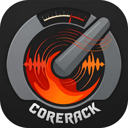
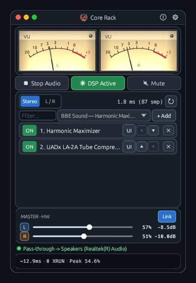
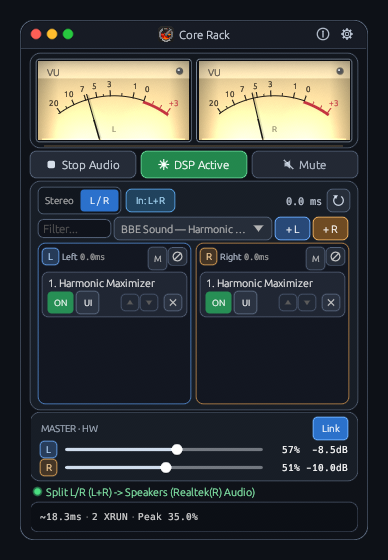

<div align="center">



# 🎛️ Core Rack

### ⚡ Audio Sistem Windows Biasa? *Upgrade Jadi Studio Rig Real-Time Tanpa Buka DAW!*

[](https://github.com/EmjiJaya/CoreRack/releases/latest)
[](https://github.com/EmjiJaya/CoreRack/releases)
[](https://github.com/EmjiJaya/CoreRack/releases/latest)
[](https://github.com/EmjiJaya/CoreRack/releases/latest)

<br />

[](https://github.com/EmjiJaya/CoreRack/releases/latest)

👉 **[Klik di sini buat langsung download `CoreRack-Setup.exe` versi terbaru!](https://github.com/EmjiJaya/CoreRack/releases/latest)**

</div>

---

## 📸 Intip Tampilannya — **Stereo Mode** vs **Split L/R Mode**!

Sama-sama **compact (`348 × 520`)**, jarum **VU Meter nggak geser-geser** pas pindah mode, tinggal pilih mau pakai **Stereo** chain atau split **L/R** buat crossover/bi-amp!

<div align="center">

| 🎧 **Stereo Mode** *(Master Chain)* | 🔀 **Split L/R Mode** *(Independent Track L & R)* |
| :---: | :---: |
|  |  |
| Rantai plugin serial stereo mulus (`BBE`, `UADx`, `SSL Native`, dll.) lengkap dengan readout PDC latency! | Channel **Track L** & **Track R** terpisah berdampingan dengan **Auto-PDC**, **Mute (`M`)**, **180° Polarity Invert (`Ø`)**, & input **In: L+R / L\|R**! |

</div>

---

## 🤔 Apa Sih **Core Rack** Itu?

Pernah pengen dengerin **YouTube, Spotify, game, atau browser** lewat plugin **VST3 favorit kamu** *(EQ, Compressor, Saturator, Bus FX, dll.)* tapi mager banget buka DAW berat-berat?

**Core Rack** adalah **Real-Time VST3 Audio DSP Host** berbasis **Rust** yang ringan, compact, dan langsung standby di **Windows System Tray**! Cukup sekali set routing, seluruh audio PC kamu bisa diproses **live 48 kHz** lewat rantai plugin VST3 pilihanmu — tampilannya pun clean **frosted dark glass (`348 × 520 px`)** dengan **Dual Analog VU Meter** bergaya vintage studio.

---

## 🔥 Fitur Andalannya Apa Aja?

| ✨ Fitur | 🛠️ Penjelasan Singkat Biar Kebayang |
| :--- | :--- |
| ⚡ **Lock-Free 48 kHz Engine** | Audio engine WASAPI pakai lock-free `rtrb` ring buffer — minim glitch, buffer size bisa diatur, hot-switch output device tanpa reset plugin, plus live telemetry (`~ms`, `XRUN`, `OVR`, `Peak %`, `CLIP`). |
| 🧩 **Serial VST3 Plugin Rack** | Fast scan `.vst3` di Windows + filter pencarian, pasang multi-slot seri, reorder naik/turun, per-slot bypass, **Global DSP Bypass**, dan buka jendela **native UI** tiap plugin. Kompatibel mulus sama plugin **SSL Native, BBE Sound, UADx**, dll. |
| 🔀 **Stereo & Split L/R Mode** | Mau proses **Stereo** langsung gas, atau pisah channel **L / R** buat **2-way crossover / bi-amp**? Ada mode **L+R (Mono Sum)** & **L\|R (Discrete)** lengkap sama **Auto-PDC** *(Automatic Plugin Delay Compensation)*, track **Mute (`M`)**, dan **180° Polarity Invert (`Ø`)**. |
| 🎚️ **MASTER · HW Fader** | Ngatur volume langsung ke **Windows Hardware Endpoint L/R** (bisa **Link** atau independent L/R), jadi jalur DSP & jarum VU meter tetap kerja di headroom optimal. |
| 📟 **Dual Analog VU Meter** | Membaca **Output (Post-DSP, Pre-`MASTER · HW`)** setelah seluruh VST3 chain & hard clamp `[-1.0, 1.0]`. Jarum VU bergaya vintage backlit (`0 VU = -14 dBFS`) dengan 80 ms RMS ballistics, redaman halus, dan LED Peak L/R tersendiri — jadi levelnya tidak berubah saat fader hardware digeser. |
| 🪟 **Compact Glass UI & System Tray** | Panel mungil `348 × 520` translucent dark glass dengan mode **Always-on-Top**, kontrol cepat lewat klik kanan **System Tray**, dan otomatis nyimpan seluruh konfigurasi & preset plugin VST3 kamu. |
| 🔄 **In-App Auto-Updater** | Cek update tinggal klik **About → Check**! Download diverifikasi **SHA-256** di background tanpa memutus audio yang lagi jalan. |

---

## 🗺️ Cara Kerja Signal Flow Audio

```text
🎵 Browser / Spotify / Game
        │
        ▼  (Output diarahkan ke)
🔌 VB-Audio Virtual Cable (CABLE Input ──► CABLE Output)
        │
        ▼  (Ditangkap real-time 48 kHz oleh Core Rack)
🎛️ Core Rack VST3 Rack
   ├── Mode Stereo    : Chain Plugin 1 ──► 2 ──► ... ──► Limiter Guard
   └── Mode Split L/R : L+R / L|R ──► Track L & R + Auto-PDC + Ø Invert
        │
        ├──► 📟 Analog VU Meter (Output Post-DSP) + Peak Telemetry
        │
        ▼  (MASTER · HW Endpoint Volume Control)
🔊 Speaker / DAC / Audio Interface Kamu!
```

---

## 🚀 Cara Install & Setup Pertama Kali (Anti Ribet!)

1. **Download Installer**  
   Ambil file **`CoreRack-Setup-<versi>.exe`** terbaru di halaman **[GitHub Releases](https://github.com/EmjiJaya/CoreRack/releases/latest)**.

2. **Jalankan Installer (Auto-Check VB-Audio)**  
   Klik 2× installer-nya:
   - Core Rack butuh **VB-Audio Virtual Cable** buat jalur input audio virtual.
   - **Belum punya VB-Audio?** Tenang! Installer bakal otomatis check & kasih pop-up notifikasi; kalau kamu klik **Yes**, browser langsung ngebuka halaman resmi **[vb-audio.com/Cable](https://vb-audio.com/Cable/)** buat kamu download.
   - *Catatan SmartScreen:* Kalau Windows munculin *"Windows protected your PC"*, klik **More info → Run anyway** ya (build ini belum pakai sertifikat komersial berbayar).

3. **Setting Audio 48 kHz di Windows**  
   - Pastikan sample rate **VB-Audio (`CABLE Input` & `CABLE Output`)** dan **Speaker/DAC** kamu diset ke **48.000 Hz** *(48 kHz, 24-bit/16-bit)*.
   - Set output app pemutar musik/browser ke **`CABLE Input`**.
   - Buka **Core Rack** (atau klik ⚙️ **Settings** `Ctrl+,`) lalu pastikan **Input = `CABLE Output`** dan **Output = Speaker/DAC kamu**.
   - Tambah plugin `.vst3` favorit di rack — **kelar, langsung nikmati bedanya!**

---

## 🔄 Cara Update Aplikasi Nanti (Auto-Update Inside!)

Nggak perlu bolak-balik cari installer manual lagi kalau ada versi baru:

1. Klik ikon **`i`** *(pojok kanan atas)* atau klik kanan system tray icon → **About Core Rack**.
2. Di kartu **SOFTWARE UPDATE**, klik **Check**.
3. Kalau ada versi baru: klik **Download** *(audio kamu tetap muter normal tanpa putus)* → setelah lolos verifikasi **SHA-256**, klik **Install & Restart** — beres, seluruh plugin & preset otomatis kebuka lagi.

---

## 💻 Minimum Requirements

- 🖥️ **OS:** Windows 10 / Windows 11 (**64-bit / x64**)
- 🔌 **Audio Routing:** VB-Audio Virtual Cable *(gratis dari VB-Audio, dicek otomatis oleh installer)*
- 🧩 **Plugin:** VST3 64-bit *(opsional, bisa langsung jalan sebagai pass-through / hardware gain + VU meter juga)*

---

<div align="center">

### 🏆 Official Release Channel

**Licensed by:** **Emji Jaya** · **Developer:** **Thonilux Neon**

📦 *[Browse All Releases & Checksums (`SHA256SUMS.txt`)](https://github.com/EmjiJaya/CoreRack/releases)*

© 2026 **Emji Jaya** · Developed by **Thonilux Neon**. All rights reserved.

</div>